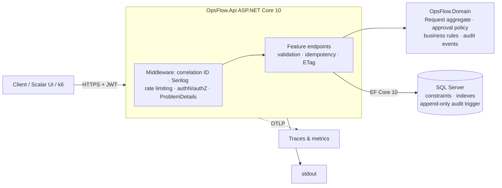
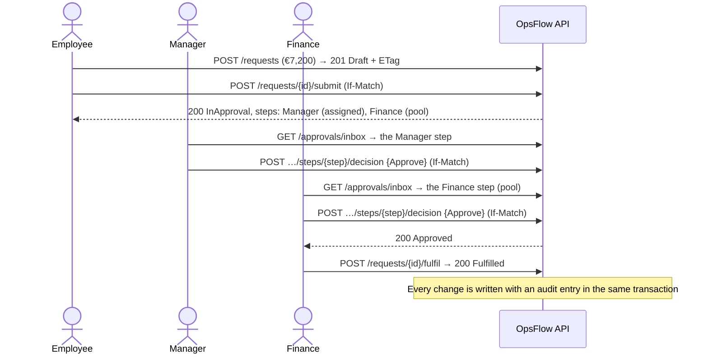

# OpsFlow: Approval Workflows API

[](https://github.com/silverricardo/opsflow-api/actions/workflows/ci.yml)


[](LICENSE)

A backend API for **purchase and expense approvals**. Approval chains follow a policy based on the amount,
segregation of duties is enforced, concurrent decisions stay correct, and there is a tamper-proof audit trail.
Built with ASP.NET Core 10, EF Core 10 and SQL Server.

Many small and mid-sized companies still approve spending over e-mail and spreadsheets. Requests get lost, limits
are applied inconsistently, and when finance asks *"who approved this?"* there is no reliable answer. OpsFlow
makes that process explicit, enforceable and auditable.

---

## Highlights

| | |
|---|---|
| **Domain rules in a pure domain model** | The lifecycle is a state machine. The approval chain (Manager → Finance > €5k → Director > €50k) is derived from data and snapshotted at submission. Nobody approves their own request or decides twice in a round, and a chain that could never finish is rejected up front. 120 domain tests, including every *status × operation* combination. |
| **Correct under concurrency** | Optimistic concurrency on the aggregate (`rowversion` → `ETag` / `If-Match`). Concurrent tests repeated 20× per run found two real race bugs; both are fixed and documented. |
| **Safe retries** | `Idempotency-Key` on every POST: the original response is replayed byte for byte, and a key reused for a different body is rejected. A failure after the commit never causes a second execution (fault-injection test). |
| **Security by default** | Fallback authorization policy, role policies, visibility filtered **in SQL** (hidden requests return `404`), sign-in rate limited per IP *and* per account, an append-only audit trail enforced by a database trigger, and no secrets in the repository. |
| **Measured performance** | A k6 load test on 100k requests showed the visibility query was using no index (~743k logical reads per `COUNT`). After a rewrite: ~2k reads and 3× the throughput. [Method and results](perf/README.md). |
| **Production-minded operations** | RFC 9457 errors with stable codes, correlation IDs from request to log to audit, OpenTelemetry, liveness and readiness probes, a chiseled non-root container, a migration bundle, and CI with SHA-pinned actions. |

## Architecture



A **modular monolith**:
- a dependency-free domain project holds every business rule;
- the API project is organised by feature, and uses `DbContext` directly rather than a repository layer;
- the trade-offs are explained in the [ADRs](docs/architecture-decisions.md).

### How an approval works



The full lifecycle (with *changes requested*, resubmission rounds, rejection and cancellation), the ER diagram
and the API contract are in [docs/design.md](docs/design.md).

## Tech stack

| Area | Choice |
|---|---|
| Runtime and API | .NET 10 (LTS), ASP.NET Core minimal APIs, OpenAPI + Scalar |
| Data | SQL Server 2022, EF Core 10 (migrations, check constraints, filtered and covering indexes) |
| Validation and errors | FluentValidation, RFC 9457 Problem Details |
| Security | JWT bearer, ASP.NET Core rate limiting, PBKDF2 password hashing |
| Observability | Serilog (JSON), OpenTelemetry (OTLP), health checks |
| Testing | NUnit, Moq, Testcontainers (real SQL Server), `WebApplicationFactory`, k6 |
| Delivery | Docker (chiseled, non-root), Docker Compose, GitHub Actions |

Every dependency is pinned centrally and licensed MIT, Apache-2.0 or BSD-3-Clause. MediatR, AutoMapper and
FluentAssertions are deliberately avoided, because they are now commercially licensed ([ADR-009](docs/architecture-decisions.md)).

## Quick start (Docker)

Requirements: Docker Desktop, or Docker Engine with Compose v2. Leave about 3 GB of free RAM for SQL Server.

```bash
git clone https://github.com/silverricardo/opsflow-api.git && cd opsflow-api
cp .env.example .env            # Windows PowerShell: Copy-Item .env.example .env
docker compose up -d --build    # first run: ~2–5 min (image downloads, migrations, demo data)
```

| | |
|---|---|
| API reference (Scalar) | http://localhost:8080/scalar |
| Readiness | http://localhost:8080/health/ready |
| Request samples | [`http/opsflow.http`](http/opsflow.http) (VS Code REST Client, Visual Studio, Rider) |

**Demo users** are created locally on first start. They all share the password set in `SEED_DEMO_PASSWORD` in
your `.env`:

| E-mail | Role | Try |
|---|---|---|
| `employee1@opsflow.local` | Employee (reports to manager1) | Create and submit requests |
| `manager1@opsflow.local` | Manager | Approve from the inbox |
| `finance@opsflow.local` | Finance | Approve over €5k; mark as fulfilled. One request is waiting in the inbox |
| `director@opsflow.local`, `director2@opsflow.local` | Director | Approve over €50k |
| `admin@opsflow.local` | Admin | Reassign steps, list users, read everything |

The demo data covers six statuses: draft, in approval, changes requested, rejected, cancelled and fulfilled.

### Example

```bash
TOKEN=$(curl -s -X POST http://localhost:8080/api/v1/auth/token -H 'Content-Type: application/json' \
  -d '{"email":"employee1@opsflow.local","password":"<SEED_DEMO_PASSWORD>"}' \
  | sed -E 's/.*"accessToken":"([^"]+)".*/\1/')

curl -i -X POST http://localhost:8080/api/v1/requests \
  -H "Authorization: Bearer $TOKEN" -H 'Content-Type: application/json' -H 'Idempotency-Key: demo-1' \
  -d '{"title":"New laptop","category":"Purchase","amount":1450}'
```

<details>
<summary>Windows PowerShell</summary>

```powershell
$token = (Invoke-RestMethod -Method Post -Uri http://localhost:8080/api/v1/auth/token -ContentType 'application/json' `
  -Body '{"email":"employee1@opsflow.local","password":"<SEED_DEMO_PASSWORD>"}').accessToken
Invoke-WebRequest -Method Post -Uri http://localhost:8080/api/v1/requests -ContentType 'application/json' `
  -Headers @{ Authorization = "Bearer $token"; 'Idempotency-Key' = 'demo-1' } `
  -Body '{"title":"New laptop","category":"Purchase","amount":1450}'
```
</details>

Response, captured from a fresh clone of this repository:

```http
HTTP/1.1 201 Created
ETag: "AAAAAAAAB9w="
Location: /api/v1/requests/8

{"id":8,"reference":"REQ-000008","title":"New laptop","description":null,"category":"Purchase","amount":1450.00,
 "status":"Draft","requester":{"id":7,"displayName":"Ana Santos"},"currentRound":0,
 "createdAt":"2026-10-10T17:59:12.323+00:00","updatedAt":"2026-10-10T17:59:12.323+00:00",
 "submittedAt":null,"completedAt":null,"steps":[]}
```

Sign-in is limited to 5 attempts per minute per IP, and to 10 failed attempts per account per 15 minutes. If
you get `429` while trying the demo users, wait a minute.

Errors share one shape and carry a stable `code` for clients to branch on:

```json
{ "title": "Precondition required", "status": 428,
  "detail": "Send the request's current ETag in the If-Match header.",
  "instance": "/api/v1/requests/8/submit", "code": "concurrency.if_match_required",
  "correlationId": "216650128e56817909417d432f79a21c" }
```

## Run from source

Requirements: .NET SDK 10.0.100 or later, plus Docker for SQL Server and the integration tests.

```bash
docker compose up -d sqlserver
dotnet tool restore
cd src/OpsFlow.Api
dotnet user-secrets set "ConnectionStrings:OpsFlow" "Server=localhost,1433;Database=OpsFlow;User Id=sa;Password=<MSSQL_SA_PASSWORD>;TrustServerCertificate=True"
dotnet user-secrets set "Jwt:SigningKey" "$(openssl rand -base64 48)"
dotnet user-secrets set "Seed:DemoPassword" "<at least 12 characters>"
dotnet run    # http://localhost:5054/scalar: migrations and demo data are applied on start
```

On Windows (PowerShell), generate the key with
`[Convert]::ToBase64String((1..48 | % { Get-Random -Max 256 }))`. The other commands are the same.

## Tests and CI

```bash
dotnet test     # Docker must be running: integration tests start SQL Server via Testcontainers
```

| Suite | What it covers |
|---|---|
| `OpsFlow.Domain.Tests` (120) | Every business rule, the lifecycle table, approval policy thresholds, the eligibility matrix |
| `OpsFlow.Api.Tests` (226) | Endpoints against a real SQL Server: visibility, the role × endpoint authorization matrix, concurrency races (repeated), idempotency (including fault injection), the audit trigger, health checks, rate limits, metrics, the demo seed |

[CI](.github/workflows/ci.yml) runs on every push and pull request:
- formatting and code-style check;
- Release build with warnings as errors;
- a check that the migrations match the model;
- all tests, with results and coverage uploaded;
- a migration bundle;
- the container image build.

## Performance

The [load-test plan, method and results](perf/README.md) cover a deterministic seed of 100k requests, a
read-heavy k6 mix and database statistics for every run. The first baseline found the visibility filter
defeating every index. The fix was measured on the same data and machine:

| | Before | After |
|---|---|---|
| Logical reads per visibility `COUNT` | 742,835 | 2,068 |
| Employee list p95 | 18.1 s | 4.0 s |
| Throughput (20 VUs) | 5.7 req/s | 17.8 req/s |

These numbers come from an overloaded 8 GB laptop, so the absolute latencies are pessimistic and several
operations are still above the 200 ms p95 target. The perf README lists the remaining hotspots and next steps. A
manual GitHub Actions workflow runs the same test on standardised hardware.

## Documentation

| Document | Contents |
|---|---|
| [Requirements](docs/requirements.md) | Problem statement, business rules (`BR-xx`), acceptance criteria |
| [Design](docs/design.md) | Architecture, domain model, ER diagram, API contract, error codes, security model |
| [Architecture decisions](docs/architecture-decisions.md) | 10 ADRs with context and consequences |
| [Operations](docs/operations.md) | Configuration, health, logs, telemetry, troubleshooting, bottlenecks |
| [Deploying to Azure](docs/deployment-azure.md) | Container Apps + Azure SQL + Key Vault, migrations, production checklist |
| [Performance](perf/README.md) | Load-test method and measured results |
| [Security policy](SECURITY.md) | Reporting vulnerabilities, security model summary |

## Design decisions in brief

- **Modular monolith, not microservices.** One bounded context does not justify distributed transactions and
  operational overhead. The aggregate boundaries keep a later split possible.
- **No repository layer over EF Core.** `DbContext` already is a unit of work. Explicit queries are what made the
  performance fix possible.
- **Hard-coded lifecycle, data-driven approval chain.** The thresholds change without a deployment. New states
  are a code change, on purpose.
- **Self-issued JWT for the demo only.** The API validates standard bearer tokens, so production swaps in Entra
  ID or another OIDC provider by configuration.
- **Integration tests against real SQL Server.** `rowversion`, constraints, the trigger and the query plans
  cannot be tested on an in-memory provider.

## Known limitations

- Single currency (EUR) and single tenant. No notifications, attachments or delegation.
- The demo identity provider has no MFA, password reset or token revocation (tokens last 15 minutes).
- The per-account sign-in throttle is in memory and per instance.
- Lists return an exact `totalCount` (offset pagination). Inbox and list queries are still above the latency target
  in the local benchmark (see perf README).
- A user loses sight of a request once their step is reassigned before they decide it (BR-40, by design).
- One unexplained `500` appeared once during race testing. It was not reproduced in more than 1,600 further
  iterations, locally or in CI.

## Roadmap

E-mail and Teams notifications through an outbox · delegation and out-of-office · Entra ID integration ·
keyset pagination for audit and lists · an Angular or Blazor front end · multi-currency.

## License

[MIT](LICENSE). SQL Server runs from Microsoft's container image under its own Developer edition licence: free
for development and testing, not included in this repository.
