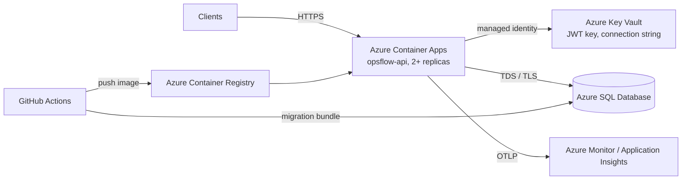

# Deploying OpsFlow to Azure

An example production path using managed services. Nothing in the application is Azure-specific: it is a
container with an environment-based configuration and a SQL Server database. The same steps map to AWS (ECS +
RDS for SQL Server + Secrets Manager) or Kubernetes.

> This guide documents a deployment path. It has not been run as part of this repository's CI. Commands use the
> Azure CLI. Resource names are examples.

## Target architecture



**Why Container Apps:** it runs the existing container unchanged, scales on HTTP load, supports liveness and
readiness probes, and integrates managed identity and Key Vault. Azure App Service for Containers is an equally
valid choice.

## 1. Provision

```bash
RG=rg-opsflow-prod; LOC=westeurope
az group create -n $RG -l $LOC
az acr create -g $RG -n opsflowacr --sku Basic
az sql server create -g $RG -n opsflow-sql -l $LOC --enable-ad-only-auth \
  --external-admin-principal-type Group --external-admin-name "OpsFlow DBAs" --external-admin-sid <group-object-id>
az sql db create -g $RG -s opsflow-sql -n opsflow --service-objective S1
az keyvault create -g $RG -n opsflow-kv --enable-rbac-authorization true
az containerapp env create -g $RG -n opsflow-env -l $LOC
```

## 2. Secrets and identity

- **Database access with no password:** give the container app a managed identity and create a contained
  database user for it with least privilege. The app never needs DDL rights, because migrations run from the
  pipeline.

  ```sql
  CREATE USER [opsflow-api] FROM EXTERNAL PROVIDER;
  ALTER ROLE db_datareader ADD MEMBER [opsflow-api];
  ALTER ROLE db_datawriter ADD MEMBER [opsflow-api];
  -- The audit trigger also blocks UPDATE/DELETE on AuditEntries for this login (BR-52).
  ```

  Connection string (no secret in it): `Server=tcp:opsflow-sql.database.windows.net;Database=opsflow;Authentication=Active Directory Default;Encrypt=True`

- **JWT signing key** in Key Vault (`openssl rand -base64 48`), exposed to the app as a Key Vault secret
  reference mapped to `Jwt__SigningKey`.
- In production, replace the demo token endpoint with **Microsoft Entra ID** (ADR-006). Point `Jwt__Issuer`,
  `Jwt__Audience` and the signing keys at the tenant (an OIDC metadata change) and map app roles to the
  `role` claim.

## 3. Database migrations

Migrations run **from the pipeline before the new version receives traffic**, never from application startup
(`Database__MigrateOnStartup=false`, the default):

```bash
# Built and verified by CI (artifact "efbundle-linux-x64" on main):
./efbundle --connection "Server=tcp:...;Authentication=Active Directory Default;..."
```

For a DBA review, generate the idempotent SQL script instead:
`dotnet ef migrations script --idempotent --project src/OpsFlow.Api -o migrate.sql`.

Keep migrations **backward compatible** (expand, then contract), so the previous version keeps working while the
new one rolls out.

**Index builds on large tables.** Migrations run with a 10-minute command timeout, because the default 30 s was
exceeded when an index was added to a 100k-request database during the load tests. For large production tables:
- schedule index migrations outside peak hours;
- consider `ONLINE = ON`, which Azure SQL and SQL Server Enterprise/Developer support. Edit the generated
  migration, or use `.IsCreatedOnline()` on the index if every target edition supports it;
- review the idempotent script with a DBA first.

## 4. Deploy the container

```bash
az acr build -r opsflowacr -t opsflow-api:$(git rev-parse --short HEAD) .
az containerapp create -g $RG -n opsflow-api --environment opsflow-env \
  --image opsflowacr.azurecr.io/opsflow-api:<sha> --target-port 8080 --ingress external \
  --min-replicas 2 --max-replicas 6 --system-assigned \
  --env-vars ASPNETCORE_ENVIRONMENT=Production ConnectionStrings__OpsFlow="<as above>" \
             Jwt__SigningKey=secretref:jwt-signing-key OTEL_EXPORTER_OTLP_ENDPOINT=<collector>
```

Configure probes: **liveness** `GET /health/live`, **readiness** `GET /health/ready`, with an initial delay of
about 10 s.

## 5. Production checklist

- [ ] `ASPNETCORE_ENVIRONMENT=Production` (seeding refused, JSON logs, HSTS).
- [ ] **`ForwardedHeaders__Enabled=true`:** Container Apps / App Service terminate TLS and forward the client IP.
      Without this, rate limiting puts every client in the proxy's partition. Enable it only when the app is
      reachable exclusively through the platform ingress (only the nearest hop is trusted).
- [ ] Managed identity for SQL. No SQL passwords anywhere.
- [ ] Key Vault references for secrets. Rotate the JWT key by deploying the new key; tokens expire within 15
      minutes.
- [ ] Migration bundle run in the pipeline before the rollout.
- [ ] Probes configured; at least 2 replicas.
- [ ] OTLP export and alerts on 5xx rate, p95 latency and readiness failures.
- [ ] Azure SQL: automatic backups (point-in-time restore) and Query Store enabled (it is on by default).
