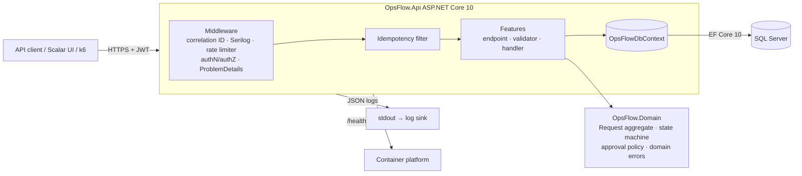
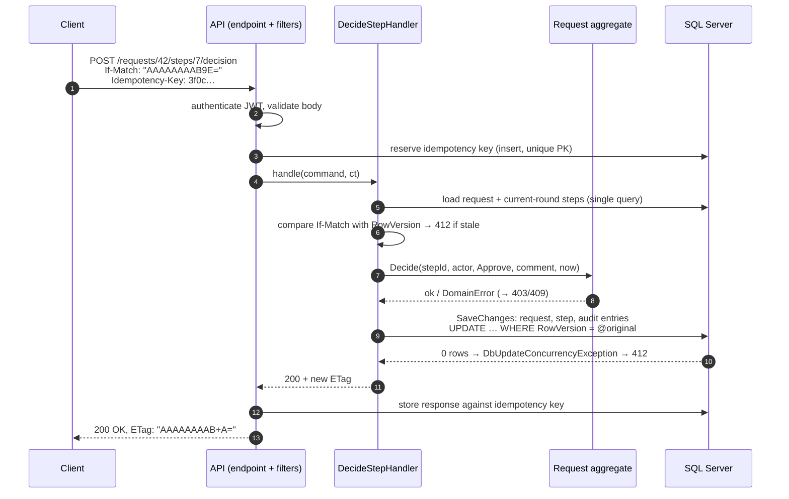
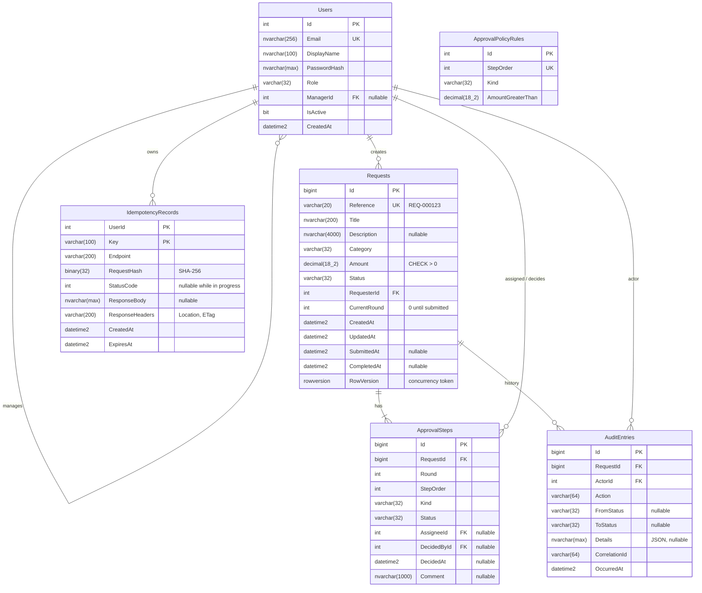

# OpsFlow — Design

Implements [requirements.md](requirements.md). Rationale for key choices is in
[architecture-decisions.md](architecture-decisions.md).

## 1. Architecture overview



Dependency rule: `OpsFlow.Domain` has no project or package dependencies. `OpsFlow.Api` references the domain.
Handlers load the aggregate through the `DbContext`, call domain methods, and save once.

### Request flow for a command (approve a step)



## 2. Domain model

### Aggregate: `Request` (root)

Owns its `ApprovalStep`s. All state changes go through methods on `Request`, and each method
returns success or a `DomainError` (code + message). There are no public setters. The aggregate records
`AuditEvent`s that the persistence layer turns into `AuditEntry` rows within the same `SaveChanges`.

| Method | Allowed from | Effect |
|---|---|---|
| `Create(requester, title, description, category, amount, now)` | — | `Draft`; audit `RequestCreated` |
| `Update(actor, title, description, category, amount, now)` | `Draft`, `ChangesRequested` | audit `RequestUpdated` |
| `Submit(actor, requesterManagerId, policy, now)` | `Draft`, `ChangesRequested` | new round, steps generated; `InApproval`; audit `RequestSubmitted` |
| `Decide(stepId, actor, decision, comment, now)` | `InApproval` | step decided; may transition to `Approved` / `Rejected` / `ChangesRequested` |
| `ClaimStep(stepId, actor, now)` | `InApproval` | assigns an unassigned pool step |
| `ReassignStep(stepId, admin, newAssignee, now)` | `InApproval` | changes the assignee |
| `Cancel(actor, now)` | `Draft`, `InApproval`, `ChangesRequested` | `Cancelled`; pending steps `Skipped` |
| `Fulfil(actor, now)` | `Approved` | `Fulfilled` |

`actor` is a small value object (`UserId`, `Role`) built from the authenticated principal and the users table.
The domain never reads `HttpContext` or the clock directly. Time comes in as a parameter, supplied by `TimeProvider`.

### `ApprovalPolicy`

A pure function: `IReadOnlyList<StepTemplate> StepsFor(decimal amount)`. It is built from `ApprovalPolicyRule` rows,
loaded once per submission. The resulting steps are copied onto the request (BR-10).

### Enumerations

- `RequestStatus`: `Draft`, `InApproval`, `ChangesRequested`, `Approved`, `Rejected`, `Cancelled`, `Fulfilled`
- `RequestCategory`: `Purchase`, `Expense`
- `StepKind` (the required role): `Manager`, `Finance`, `Director`
- `StepStatus`: `Pending`, `Approved`, `Rejected`, `ChangesRequested`, `Skipped`
- `Decision`: `Approve`, `Reject`, `RequestChanges`
- `UserRole`: `Employee`, `Manager`, `Finance`, `Director`, `Admin`

Enums are stored as `varchar(32)` strings. That keeps them readable in SQL and in support queries,
at a negligible size cost at this scale.

## 3. Database schema



All timestamps are UTC, stored as `datetime2(3)`.

### Constraints

- `CK_Requests_Amount`: `Amount > 0 AND Amount <= 1000000`
- `CK_Requests_Status`, `CK_ApprovalSteps_Status`, and so on: each enum column is limited to its known values.
- `UQ_ApprovalSteps_Request_Round_Order`: unique (`RequestId`, `Round`, `StepOrder`).
- `Reference` comes from the SQL sequence `RequestReferenceSeq` and is unique.
- Foreign keys use `ON DELETE NO ACTION`. Nothing is hard-deleted in the MVP.
- `AuditEntries` has an `INSTEAD OF UPDATE, DELETE` trigger that raises an error (BR-52). It is created in a migration.

### Indexes and the queries they serve

| Index | Query served |
|---|---|
| `IX_Requests_RequesterId_Status_CreatedAt` (incl. `Title, Amount, Reference, Category, UpdatedAt`) | "My requests" list, filtered by status, newest first |
| `IX_Requests_Status_CreatedAt` (same includes) | Finance/Director/Admin lists filtered by status |
| `IX_ApprovalSteps_AssigneeId_Pending` filtered `WHERE Status = 'Pending'` | Inbox: steps assigned to me |
| `IX_ApprovalSteps_Kind_Pending_Unassigned` filtered `WHERE Status = 'Pending' AND AssigneeId IS NULL` | Inbox: role pool |
| `IX_AuditEntries_RequestId_OccurredAt` | Audit history for one request |
| `IX_IdempotencyRecords_ExpiresAt` | Cleanup of expired keys |
| `UQ_Users_Email` | Login |

Phase 6 validates these against actual execution plans with 100k+ rows. Any index that isn't
used gets removed.

## 4. API contract (`/api/v1`)

| Method & path | Who | Success | Notes |
|---|---|---|---|
| `POST /auth/token` | anonymous | `200` `{ accessToken, expiresAt }` | Rate limited |
| `GET /me` | any | `200` | id, email, displayName, role, managerId |
| `GET /users?role=` | Admin | `200` paged | For reassignment |
| `POST /requests` | non-Admin | `201` + `Location`, `ETag` | Idempotency-Key supported |
| `GET /requests` | any | `200` paged | Visibility rules applied |
| `GET /requests/{id}` | visible | `200` + `ETag` | Includes current-round steps |
| `PUT /requests/{id}` | requester | `200` + `ETag` | `If-Match` required |
| `POST /requests/{id}/submit` | requester | `200` + `ETag` | `If-Match`; Idempotency-Key |
| `POST /requests/{id}/cancel` | requester | `200` + `ETag` | `If-Match`; Idempotency-Key |
| `POST /requests/{id}/fulfil` | Finance | `200` + `ETag` | `If-Match`; Idempotency-Key |
| `POST /requests/{id}/steps/{stepId}/decision` | eligible | `200` + `ETag` | Body `{ decision, comment }`; `If-Match`; Idempotency-Key |
| `POST /requests/{id}/steps/{stepId}/claim` | eligible | `200` + `ETag` | `If-Match` |
| `PUT /requests/{id}/steps/{stepId}/assignee` | Admin | `200` + `ETag` | Body `{ userId }`; `If-Match` |
| `GET /requests/{id}/audit` | visible | `200` paged | Oldest first |
| `GET /approvals/inbox` | Manager, Finance, Director | `200` paged | Current, decidable steps |
| `GET /health/live`, `GET /health/ready` | anonymous | `200` / `503` | Outside `/api/v1` |

### List query conventions

`?page=1&pageSize=20&sort=-createdAt&status=InApproval&category=Purchase&minAmount=100&maxAmount=5000&createdFrom=2026-01-01&createdTo=2026-12-31&q=laptop`

- `pageSize` defaults to 20, with a maximum of 100. `page` starts at 1.
- `sort` accepts one whitelisted field (`createdAt`, `updatedAt`, `amount`, `reference`). A `-`
  prefix means descending, and the default is `-createdAt`. `Id` is always added as a tiebreaker so the order is stable.
- `q` matches the start of `Reference` or any part of `Title`.
- Response:

```json
{
  "items": [ { "id": 42, "reference": "REQ-000042", "title": "...", "category": "Purchase",
               "amount": 1200.00, "status": "InApproval", "requester": { "id": 5, "displayName": "..." },
               "createdAt": "2026-10-09T10:00:00.000Z", "updatedAt": "..." } ],
  "page": 1, "pageSize": 20, "totalCount": 137, "totalPages": 7
}
```

### ETags

`ETag` is the base64 of `RowVersion`, as a strong ETag (`"AAAAAAAAB9E="`). Any change to the
request or its steps updates the row version, because the handler always modifies the root. So the
ETag versions the whole aggregate.

### Error model (RFC 9457)

```json
{
  "type": "https://opsflow.dev/errors/step.not_current",
  "title": "Step is not the current approval step",
  "status": 409,
  "detail": "Step 7 cannot be decided until step 6 is completed.",
  "instance": "/api/v1/requests/42/steps/7/decision",
  "code": "step.not_current",
  "correlationId": "0HN6…",
  "errors": { }
}
```

| Status | `code` values |
|---|---|
| 400 | `validation.failed` (with `errors` map), `query.invalid_sort` |
| 401 | `auth.invalid_credentials`, `auth.unauthenticated` |
| 403 | `auth.forbidden`, `approval.self_approval`, `approval.duplicate_approver`, `step.not_assignee`, `request.not_owner` |
| 404 | `request.not_found`, `step.not_found`, `user.not_found` |
| 409 | `request.invalid_transition`, `step.not_current`, `step.already_assigned`, `idempotency.in_progress` |
| 412 | `concurrency.etag_mismatch` |
| 422 | `request.requester_has_no_manager`, `idempotency.key_reused`, `user.not_eligible` |
| 428 | `concurrency.if_match_required` |
| 429 | `rate_limit.exceeded` (with `Retry-After`) |
| 500 | `server.error` (no stack trace or internals; correlation ID only) |

## 5. Security model

**Authentication**

- `POST /auth/token` checks the email and a password hashed with ASP.NET Core `PasswordHasher<T>`
  (PBKDF2). It returns an HS256 JWT valid for 15 minutes by default (configurable).
- Claims: `sub` (user id), `email`, `role`, `jti`, `iat`. Validation checks issuer, audience,
  lifetime (30-second clock skew) and signing key.
- The signing key (≥ 256 bits) comes from configuration (`Jwt__SigningKey`). The app refuses to start
  if the key is missing or short. It is never committed: dev uses user secrets or `.env`, Azure uses Key Vault.
- Login errors are identical for an unknown email and a wrong password. Unknown emails still pay the
  hashing cost, so response time doesn't reveal which emails exist.
- Inactive users cannot get tokens. Existing tokens expire within 15 minutes, and that delay is
  documented as a trade-off.
- Production path (ADR-006): swap the local issuer for Microsoft Entra ID or another OIDC provider. Only
  JWT bearer configuration and role-claim mapping change.

**Authorization** works in three layers, each tested:

1. **Endpoint policies**: role-based (`RequireRole`), e.g. `AdminOnly`, `CanDecide`, `CanFulfil`.
2. **Resource visibility**: list and detail queries are filtered by BR-40/41 *in SQL*, never after
   loading. A request the caller can't see returns `404`.
3. **Domain rules**: ownership, segregation of duties and assignee checks live in the aggregate.
   This means they apply no matter which endpoint calls them.

**Hardening**

- HTTPS redirection and HSTS outside Development. Security headers: `X-Content-Type-Options`,
  `Referrer-Policy`, and `Cache-Control: no-store` on authenticated responses.
- Rate limiting: a fixed window of 5 req/min per IP on `/auth/token`, and a token bucket per user (or IP when
  anonymous) globally.
- Request body size limit (64 KB). Unknown JSON properties are rejected. Enums are accepted only as names.
- Logging: no passwords, tokens or `Authorization` headers. Email is logged only as a user id.
- The container runs as non-root. The database connection string is only in environment or secret store.
- CORS is off by default (pure API).

## 6. Transactions, concurrency and idempotency

- **One command = one `SaveChanges`** = one database transaction. It covers the aggregate change and its
  audit entries. There are no explicit `BeginTransaction` calls in handlers.
- **Optimistic concurrency** comes from `RowVersion` on `Requests`. The handler first compares `If-Match` with the loaded
  version (fast `412`). EF then includes the original version in the `UPDATE`'s `WHERE` clause. This
  closes the race between load and save, and the resulting `DbUpdateConcurrencyException` maps to `412`.
- **Idempotency** is an endpoint filter that runs before the handler:
  1. Look up (`UserId`, `Key`). If found with the same hash and completed → replay the stored status, body and headers.
     If found with a different hash → `422`. If found but not completed → `409 idempotency.in_progress`.
  2. Otherwise insert an in-progress record (the unique PK settles concurrent duplicates), then run the handler.
  3. Store the response on success. On a `5xx`, delete the record so the client can retry.
     Responses in the `4xx` range are stored, because retrying an identical invalid command should give the same answer.
  4. Records expire after 24 hours. A background cleanup runs hourly.

  The reservation and the command use separate transactions (a deliberate trade-off — see ADR-005).

## 7. Read-side performance rules

- Every query is read-only and projects straight into the response DTO with `Select`, so it
  never loads whole entities. Projections need no `AsNoTracking`. Detail queries that load entities for display use it.
- Command handlers load the aggregate with its *current round* steps in one query
  (filtered `Include`, `AsSplitQuery` not needed for one collection).
- No lazy loading (the proxies package isn't referenced), so N+1 queries can't happen by accident.
  An integration test asserts the number of SQL commands per list request.
- `COUNT` and page queries share one filter expression. A large `totalCount` is an accepted cost at
  this scale, and keyset pagination is listed as future work (ADR-008).

## 8. Seed data

- Runs only when `Seed__Enabled=true` **and** the environment is not `Production`.
- Users: 1 Admin, 1 Director, 2 Managers (reporting to the Director), 1 Finance, 4 Employees
  (2 per Manager). All share a demo password from configuration (`Seed__DemoPassword`), and there is no
  hard-coded default. `.env.example` contains an obviously local-only placeholder.
- Includes the approval policy rules and ~15 requests across every status, created **through domain
  methods** so the seed data is always valid.
- A separate `perf` seeding mode, used in Phase 6, generates ~100k requests for load testing.
