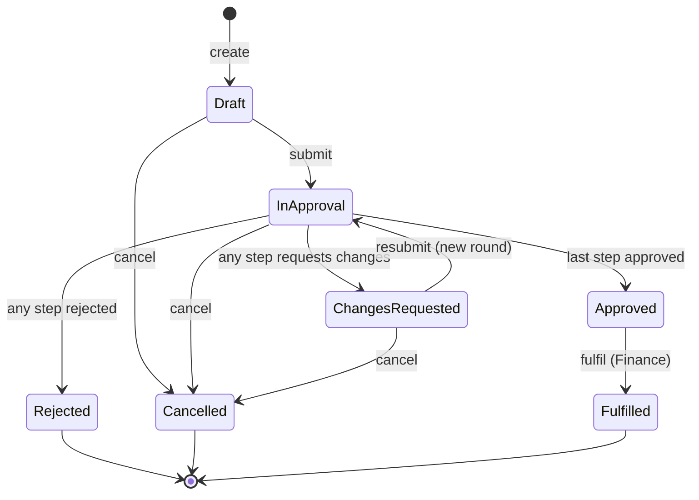

# OpsFlow — Requirements

> Status: **Agreed scope for v1.0 (MVP)**. Changes to this document must be reflected in
> [design.md](design.md) and in the test suite.

## 1. Problem statement

Small and medium-sized companies frequently approve purchases and expenses over email and
spreadsheets. Requests get lost in inboxes, nobody knows who currently holds them, spending
limits are applied inconsistently, and there is no reliable audit trail when finance or an
auditor asks *who approved what, and when*.

OpsFlow is a backend API that turns this into an explicit, auditable approval process:
requests follow a defined lifecycle, the approval chain is derived from a policy based on the
amount, segregation of duties is enforced, and every significant action is recorded.

## 2. Users and roles

Every user has exactly one role. Every authenticated user (except `Admin`) can create requests.

| Role | Description | Can additionally… |
|---|---|---|
| `Employee` | Regular staff member | — |
| `Manager` | Line manager of one or more users | Decide the *Manager* approval step for direct reports |
| `Finance` | Finance team member | Decide the *Finance* step; mark approved requests as fulfilled; see all requests |
| `Director` | Senior budget holder | Decide the *Director* step; see all requests |
| `Admin` | System administrator | See all requests and audit history; reassign approval steps; list users. Does **not** create or decide requests |

Each non-admin user may have a `Manager` (a user with role `Manager` or `Director`).

## 3. Request lifecycle

`Rejected`, `Cancelled` and `Fulfilled` are terminal.

## 4. Business rules

Rule IDs are referenced from tests (`BR-xx` in test names or descriptions).

### Requests
- **BR-01** A request has a title (3–200 chars), an optional description (≤ 4000 chars), a
  category (`Purchase` or `Expense`) and an amount in EUR (> 0 and ≤ 1,000,000.00, two decimals).
- **BR-02** Each request receives a unique, human-readable reference (e.g. `REQ-000123`) on creation.
- **BR-03** Only the requester can edit a request, and only while it is `Draft` or `ChangesRequested`.
- **BR-04** Only the requester can submit or cancel a request. Cancel is allowed from `Draft`,
  `InApproval` and `ChangesRequested`.
- **BR-05** Any transition not shown in the lifecycle diagram is rejected.

### Approval chain
- **BR-10** On submission, the approval chain is generated from the approval policy and
  **snapshotted** onto the request. Later policy changes do not affect requests already in approval.
- **BR-11** Default policy (seeded data):

  | Order | Step | Required when amount… | Eligible deciders |
  |---|---|---|---|
  | 1 | Manager | always | The requester's manager (auto-assigned) |
  | 2 | Finance | > 5,000.00 | Any `Finance` user |
  | 3 | Director | > 50,000.00 | Any `Director` user |

- **BR-12** Submission fails if the requester has no manager.
- **BR-13** Steps are decided strictly in order; only the *current* step (lowest pending order in
  the current round) can be decided.
- **BR-14** Possible decisions: `Approve`, `Reject`, `RequestChanges`. `Reject` and
  `RequestChanges` require a comment (1–1000 chars); `Approve` allows an optional comment.
- **BR-15** Approving the last step moves the request to `Approved`. Rejecting moves it to
  `Rejected`. Requesting changes moves it to `ChangesRequested`. In both of the last two cases,
  remaining pending steps of the round become `Skipped`.
- **BR-16** Resubmitting from `ChangesRequested` starts a **new round** with a freshly generated
  chain (the amount may have changed). Earlier rounds are kept for history.
- **BR-17** Cancelling a request in `InApproval` marks its pending steps as `Skipped`.

### Segregation of duties and assignment
- **BR-20** A user can never decide a step on their own request.
- **BR-21** A user can decide at most one step per request round.
- **BR-22** The Manager step is assigned to the requester's manager at submission. Finance and
  Director steps start unassigned (role pool).
- **BR-23** An eligible user may **claim** an unassigned pool step, which assigns it to them.
- **BR-24** An `Admin` may reassign any pending step to another active user who holds the step's
  required role (the Manager step may be reassigned to any `Manager` or `Director`), subject to BR-20/BR-21.
- **BR-25** A step can be decided only by its assignee, or — if unassigned — by any eligible user
  (deciding an unassigned step implicitly assigns it to the decider).

### Fulfilment
- **BR-30** Only a `Finance` user can mark an `Approved` request as `Fulfilled`
  (e.g. the purchase order was issued or the expense reimbursed).

### Visibility
- **BR-40** `Employee` and `Manager` users can see requests they created, requests where they are
  or were assigned to/decided a step, and requests created by their direct reports.
- **BR-41** `Finance`, `Director` and `Admin` users can see all requests.
- **BR-42** A request that exists but is not visible to the caller is reported as **not found**,
  so that the API does not reveal which requests exist.

### Audit
- **BR-50** Every state-changing action on a request (create, update, submit, decide, claim,
  reassign, cancel, fulfil, and the resulting status changes) produces an audit entry recording
  the actor, UTC timestamp, action, previous/new status where relevant, details, and correlation ID.
- **BR-51** Audit entries are written in the **same database transaction** as the change they
  describe. Either both are stored or neither is.
- **BR-52** Audit entries are append-only: the database rejects updates and deletes.
- **BR-53** Users who can see a request can read its audit history.

### Concurrency and retries
- **BR-60** Every state-changing operation on an existing request requires the request's current
  version (`If-Match` header with the `ETag`). A missing header is rejected; a stale version is
  rejected without applying any change.
- **BR-61** `POST` commands accept an optional `Idempotency-Key` header. Repeating a request with
  the same key and the same payload returns the original response without repeating the effect.
  Reusing a key with a different payload is rejected.

## 5. Non-functional requirements

| ID | Requirement |
|---|---|
| NFR-01 | All error responses use RFC 9457 Problem Details with a stable, machine-readable `code`. |
| NFR-02 | Every log line for a request carries a correlation ID (`X-Correlation-Id`, generated if absent, echoed in the response). |
| NFR-03 | Liveness (`/health/live`) and readiness (`/health/ready`, includes database) endpoints. |
| NFR-04 | The database schema is created exclusively through EF Core migrations; startup is reproducible from an empty SQL Server. |
| NFR-05 | No secrets in the repository. Configuration comes from environment variables, user secrets or a secret store. |
| NFR-06 | The token endpoint is rate limited; the API has a global rate limit per user/IP. |
| NFR-07 | List endpoints are paginated (max page size 100) and only allow sorting by whitelisted fields. |
| NFR-08 | All asynchronous I/O accepts and honours a `CancellationToken`. |
| NFR-09 | A clean checkout runs with `docker compose up` and no private services. |
| NFR-10 | Performance targets (to be validated in Phase 6, **not yet measured**): p95 < 200 ms for `GET /requests` (page size 20) and decisions, at 50 concurrent virtual users against 100k requests on a developer machine. |

## 6. Acceptance criteria (MVP)

Each criterion maps to at least one automated test.

1. **Authentication** — Given valid seeded credentials, `POST /api/v1/auth/token` returns a JWT;
   invalid credentials return `401` with no indication of which field was wrong; the 6th attempt
   within a minute from the same IP returns `429`.
2. **Create** — An `Employee` creates a request → `201`, `Location` and `ETag` headers, status
   `Draft`, unique reference, audit entry `RequestCreated`.
3. **Validation** — Invalid title/amount/category → `400` with field-level errors.
4. **Submit (small amount)** — Submitting a €1,200 request creates exactly one step (Manager),
   assigned to the requester's manager; status `InApproval`.
5. **Submit (large amount)** — Submitting a €75,000 request creates Manager, Finance and Director
   steps in that order.
6. **No manager** — Submitting when the requester has no manager → `422 request.requester_has_no_manager`.
7. **Ordering** — Deciding the Finance step while the Manager step is pending → `409 step.not_current`.
8. **Self-approval** — A requester who is also eligible for a step cannot decide it → `403 approval.self_approval`.
9. **Full approval** — Approving all steps moves the request to `Approved`; audit history shows each decision in order.
10. **Rejection** — Rejecting without a comment → `400`; with a comment → `Rejected`, remaining steps `Skipped`.
11. **Changes requested and resubmission** — The request returns to the requester, is edited and
    resubmitted, and a round-2 chain is generated reflecting the new amount.
12. **Concurrency** — Two approvers decide the same step concurrently with the same `ETag`:
    exactly one succeeds; the other receives `412`.
13. **Missing version** — A decision without `If-Match` → `428`.
14. **Idempotency** — Repeating `POST /requests` with the same `Idempotency-Key` and body returns
    the same `201` response body and creates one request; a different body with the same key → `422`.
15. **Visibility** — An unrelated `Employee` requesting another user's request → `404`.
16. **Authorization matrix** — Every endpoint returns the expected status for each role
    (table-driven test).
17. **Claim and reassign** — Finance user claims a pool step; Admin reassigns it to another Finance user;
    the previous assignee can no longer decide it.
18. **Fulfil** — Only `Finance` can fulfil, only from `Approved`.
19. **Lists** — `GET /requests` filters by status, category, amount range, date range and text;
    sorts by whitelisted fields; rejects unknown sort fields with `400`; returns pagination metadata.
20. **Inbox** — `GET /approvals/inbox` returns current steps the caller can decide (assigned to
    them, or unassigned pool steps for their role), excluding their own requests.
21. **Audit immutability** — A direct SQL `UPDATE`/`DELETE` on the audit table fails.
22. **Health** — `/health/live` returns `200` without the database; `/health/ready` returns `503` when the database is unreachable.

## 7. Out of scope for v1.0

Documented as known limitations / future work: workflow designer or runtime-configurable states;
multi-currency; multi-tenancy; email/Teams notifications; outbox and messaging; attachments;
delegation / out-of-office; refresh tokens and external identity provider integration (design
supports it — see ADR-006); frontend UI; user management endpoints beyond listing; SLA escalation.
